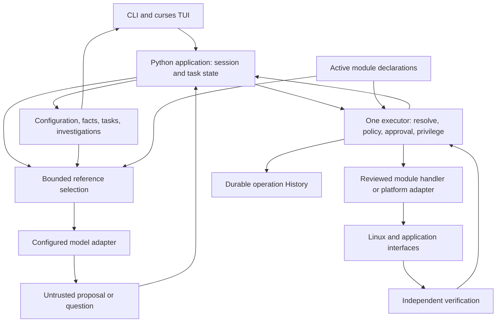

# Igor 2 architectural audit and development reset

Status: **audit delivered; recommended architecture remains DISCOVERY**.

Completed: 2026-10-17. Source baseline: local `igor2`, `1aac86a`, initially clean.
This replaces the 2026-10-01 review at this path; that review remains in Git.
The Owner's complete Igor 1 cutoff is accepted as D080. The architecture and
milestones below are recommendations, not runtime implementation authorization.
See [decisions](DECISIONS.md), [roadmap](ROADMAP.md), [cutoff plan](LEGACY.md)
and [current status](STATUS.md).

## Executive verdict

**Retain the safety and ownership semantics; substantially simplify the runtime
that implements them.** Igor is a capable experimental Linux operator with useful
machinery. It is not yet a coherent, reliably resumable system operator. Its best
path is neither a greenfield rewrite nor another layer over shell orchestration.

The strongest work is deterministic capability admission, explicit activation,
native privilege handling, verification separate from command success, private
History, and separation of reference material from authority. These are real
advantages, not architectural decoration.

The weakest work is integration: old menus can operate outside those boundaries;
configuration has competing loaders; application logic leaks into Core; machine
facts are process-local; and sophisticated evidence services feed a conversation
loop whose topic/answer continuity still relies on text heuristics. Development
has optimized individual foundations beyond the maturity of the end-to-end product.
Passing contract tests cannot establish guarantees for paths outside the contract.

The five most important changes are:

1. **Finish one safe, v2-only module platform.** Migrate shipped modules and live
   callers together; eliminate legacy execution and configuration fallback.
   Prove actual Nextcloud operations, not another metadata-only interface.
2. **Use Python for structured coordination and shell at the edges.** Reuse
   existing Python services and reviewed command implementations. Retire
   shell/JSON/subprocess plumbing and dynamic function patching as consumers move.
3. **Make the assistant a bounded, explicit task state machine.** Persist the
   question asked, selected target, operation outcomes and next step. The model
   proposes; deterministic code authorizes, executes and verifies.
4. **Remember the machine independently of conversation.** Persist last-observed
   facts with source and time, distinguish desired values and responsibility,
   and connect existing investigations to ordinary operator work.
5. **Deliver five substantial milestones with one evidence ledger each.** Keep
   critical safety tests, replace historical implementation assertions with
   behavioral coverage, and stop repeating system validation for prose.

History, configuration, investigations, collection validation and platform
adapters are reusable. Additional generic frameworks, helper agents and future
integration contracts would delay the missing product capabilities.

## Scope, method and limits

Evidence labels:

- **S — source-confirmed:** inspected implementation/call path or mechanically
  counted tracked files; not a live reproduction.
- **R — recorded:** prior candidate-bound validation/acceptance in repository
  records; not rerun or independently certified by this audit.
- **J — judgment:** interpretation, recommendation or planning estimate.
- **H — hypothesis:** plausible risk requiring a bounded experiment.

Investigation covered the tracked-file inventory, architecture/current contracts,
activation/execution/configuration/secret call paths, shipped manifests and
contribution sets, AI transport/conversation paths, frontend/backend boundaries,
persistence services, validation infrastructure, connected representative tests,
and recent history. It did **not** read every line of every fixture or execute
every test. Line references name the source baseline.

No host-changing operation, Docker operation, privileged command, live AI call,
benchmark or destructive test was run. No subagent/delegate capability was
available in the exposed tools; this is one integrated author review, not an
independent multi-reviewer consensus. The governor had 46.028 seconds remaining
at entry; no renewal was requested. Documentation validation is in STATUS.

### Size and shape

Tracked physical lines at the audit baseline, not complexity scores:

| Area | Inventory | Meaning |
|---|---:|---|
| `core/`, `modules/`, `igor.sh` | 258 files; 82,008 lines including data/assets/docs | 46,462 Bash + 27,581 Python = 74,043 executable source lines |
| `docs/` | 61 files; 28,243 lines | STATUS 4,486; module creation 1,785; roadmap 1,021 |
| `tests/` | 164 files; 39,214 lines | Includes fixtures, scripts and deprecated copies |
| Python tests | 82 `test_*.py` files; 1,003 definitions | AST definitions, not parameter-expanded collected cases |
| BATS | 59 files; 638 `@test` cases | Separate from Python counts |
| Validation/governor implementation | Approximately 2,049 lines | Useful infrastructure, substantial for this project |

Large coordination files: `core/ai/core.sh` 5,473 lines, curses TUI 3,222,
module loader 2,256, AI safety 1,700, `igor.sh` 1,630. Size alone is not a defect;
the issue is that these coordinate services already implemented in Python.

### Actual capability versus target

| Area | Implemented evidence | Limit |
|---|---|---|
| Host operations | System: 40 capabilities across host/storage/access/network, seven observers, two checks. Docker: four capabilities (S). | Availability depends on platform/dependencies/privilege; declaration count is not hardware support proof. |
| Operator UI | CLI/curses System package accepted at `5efca3d`; swap-health increment at `73a4c06` (R). | Broader application/configuration acceptance and Step 20C remain open. Source already selects TUI for interactive no-argument launch. |
| Canonical execution | Reprepare, authority/owner checks, approval, reviewed privilege adapters, History and independent verification (S). | Not universal across menus, raw commands and v1 actions. |
| Modules | Strict v2 and lifecycle filtering; System mixed v1/v2, Docker v2, Nextcloud v1 (S). | Detach assessment is inspection, not safe uninstall. Samba is an adapter, not a complete module. |
| Configuration/secrets | Desired-state service, `ai.verbose`, System warning setting, managed OpenRouter credential lifecycle (S/R). | Other credentials/settings retain legacy sources/exports. |
| Machine memory | Typed facts, freshness, observers/checks; durable deployments/operation records (S). | General observed-fact memory is process-local. |
| Investigations/learning | Durable evidence/hypotheses/findings, reviewed learning, patterns/procedures and interchange validators (S/R). | Natural-language recovery and relevant automatic recall remain incomplete. |
| AI | Anthropic/OpenRouter/Ollama, transaction-safe tools, bounded continuation, context/model-role selection (S). | No proven durable task loop or automatic cheap/strong escalation. OpenAI-named files do not prove a direct transport. |
| Nextcloud | Large operational script library, 12 v1 AI actions, recognition and metadata attachment (S). | Desired loglevel/apply/readback incomplete; prepared fixture does not prove `2 → 3 → 2`. |
| Automation/plans | Bounded sequential capability plans; durable READ-only scheduling/slot claims (S). | No general safe restart/resume of multi-step changes. |

## Prioritized technical findings

P1: release-blocking safety/reliability issue or central product gap.
P2: substantial integration/maintenance cost. P3: bounded cleanup.
Unexecuted exploits are not presented as demonstrated compromises.

### F01 — P1 / S: application menu can delete unrelated Docker data

[`_mod_services_nuke`, services.sh:50–67](../../modules/nextcloud_docker/menus/services.sh#L50)
is reachable from `menu_services` at lines 227/255. Lines 62–63 enumerate **all**
Docker volumes/images instead of the attached deployment. It uses
[`confirm`, ui.sh:48](../../core/lib/ui.sh#L48), accepting `y`, outside the canonical
exact destructive `YES` and History boundary. Errors are ignored and completion
announced. The menu warns about broad deletion; the defect is scope/authority,
not absence of a warning. In-use resources may resist deletion, but unrelated
unused data remains at risk.

**Action:** remove this host-wide action in M1. Any replacement must name only
bound deployment resources, require exact approval, declare recovery limits
and verify the result. Do not add generic Docker cleanup as an incidental feature.
No destructive invocation was performed.

### F02 — P1 / S: service failures can be reported as success

[`_mod_services_start/stop/restart`, services.sh:14–47](../../modules/nextcloud_docker/menus/services.sh#L14)
do not inspect Docker exit status before success messages and `OK` journal
entries. Normal non-errexit callers can record success after failure. Operations
also rely on Compose working-directory discovery, unlike the explicit status-pane
path. **Action:** canonical bound target, explicit Compose locator, propagate
failure and verify state. A fake failing Docker process can prove this safely.

### F03 — P1 / S,H: legacy credential diagnostics are unsafe

[`_cfg_source_env`, config_loader.sh:82–120](../../core/lib/config_loader.sh#L82)
continues after permission warnings, evaluates files with `source`, exports their
assignments, redirects errors to fixed `/tmp/_igor_cfg_src_err`, and prints those
errors without a scrub boundary. Defaults and module loading use similar fixed
files. Errors can echo credential-bearing source lines; concurrent processes can
clobber diagnostics. Symlink/truncation exploitation depends on OS protections
and was not tested. Executable local configuration is an existing trust contract,
not itself proof of remote code execution.

The managed OpenRouter pre-evaluation projection/fail-closed guard is valuable;
it covers selected aliases, not all configuration. **Action:** data-only config,
exact-consumer secret resolution, private captures, and scrubbing before display.
Prove sentinel non-exposure in errors, logs, AI requests and child environments.

### F04 — P1 / S: sourcing configuration relocates user data

[`_detect_config_dir`, config.sh:48–104](../../core/lib/config.sh#L48) moves old
HOME data/configuration/GPG trees into project paths, then moves selected secrets
again. It ignores errors and runs while configuration is sourced.
[`igor.sh:377`](../../igor.sh#L377) loads this before the newer loader. There is
no independently verified versioned migration/recovery record for these moves.
**Action:** explicit offline inventory/import; copy/verify before cutover; no
startup moves. Preserve credentials, History, learned state, backups, GPG and
native application data. See LEGACY.

### F05 — P1 / S,J: canonical authority is incomplete and placed under AI

[`capability.sh:16`](../../core/lib/capability.sh#L16) loads AI safety;
[`igor_capability_execute_plan:83`](../../core/lib/capability.sh#L83) and automation
use `ai_execute_tool`. CLI/automation authority depends on an AI-named subsystem,
while menus, `run_igor_action`, host/OCC/container tools have other conventions.

The contribution index, catalog and frontend views are **not all duplicate
authorities**. Many correctly project one registry. The duplication is competing
invocation/lifecycle contracts. **Action:** one application executor, all
interfaces submit the same typed intent; move deterministic policy ownership
without weakening or duplicating it.

### F06 — P1 / S,J: task continuity is too weak for substantial work

[`_ai_input_continues_topic`, core.sh:1879](../../core/ai/core.sh#L1879) uses word
overlap; `_ai_prepare_user_topic` can clear context. Pending choices are inferred
from prose/list/question patterns around lines 1932–2010. Continuation later
interprets textual RESULT/OUTCOME completion and uses a short bounded loop.
An unrelated-looking answer or restart is not a reliable continuation contract.

Structured plans already resolve 1–16 canonical steps and stop on failure.
**Action:** reuse that executor with a durable Task record: typed pending
questions, stable choices, target refs, admitted steps and operation IDs. Only
verified operations complete execution steps. Cancellation and unknown effects
are explicit; do not build a second planner or trust a completion sentence.

### F07 — P1 / S,J: general machine inventory is not durable

[`observation.sh:1–35`](../../core/lib/observation.sh#L1) creates a private,
process-owned runtime model file. The typed observed/desired/responsibility
separation is sound, but durable History/deployments do not persist observations.
**Action:** bounded last-observed facts, stale on restart until refreshed. Expose
source, age, native locator and responsibility. No graph database, embeddings
service or chat-derived facts. Disabled modules stop contributing active context
and refreshes; historical records remain inspectable with unavailable provenance.

### F08 — P2 / S,J: configuration and secret ownership remain split

[`config.sh`](../../core/lib/config.sh),
[`config_loader.sh`](../../core/lib/config_loader.sh),
[`configuration.py`](../../core/lib/configuration.py), and
[`secret_refs.py`](../../core/lib/secret_refs.py) coexist. Defaults, root/project
env files, HOME fallbacks, key files and native settings have different precedence
and writers. `set -a` exposes credentials to unrelated children. A schema service
for a few settings is not a complete cutover.

**Action:** package defaults → one scoped desired authority; secrets by reference
at the exact consumer. Native settings stay external unless adopted. One effective
value/source inspector; conflicts reported explicitly. Retain sound stores.

### F09 — P2 / S,J: Bash coordinates structured application state

[`module_loader_fast.sh`](../../core/lib/module_loader_fast.sh) adds 582 lines
over a 2,256-line loader, copying seven functions using `declare -f`/`eval` and
overriding them. Shell maps and child interpreters repeatedly transfer/parse
structured state. The cache has valuable authority fences and measured performance
history; deleting it alone would regress startup.

**Action:** Python imports services and owns in-memory state; shell handles
bounded OS/application work. Replace the paired loader once, retaining digest,
activation and resource constraints. Profile representative launches before
claiming gains; no new performance measurement was made here.

### F10 — P2 / S,J: dispatch repeats domain identity knowledge

[`capability.sh`](../../core/lib/capability.sh#L226) repeats System-specific
switches across prepare/precondition/invoke/verify;
[`module_contract.py`](../../core/lib/module_contract.py#L255) and
[`module_registry.py`](../../core/lib/module_registry.py) also know selected
identities. Finite privileged allowlists are legitimate; repeated binding logic
is not necessary. **Action:** one reviewed adapter table for privileged mechanics,
module-owned domain semantics and shared validation. Never replace this with
module-supplied arbitrary root commands or a generic workflow DSL.

### F11 — P2 / S,J: application logic remains in Core

[`deployment_attachment._load_provider:30`](../../core/lib/deployment_attachment.py#L30)
hardcodes Nextcloud and separately reads activation metadata.
[`diagnose/phases.sh`](../../core/diagnose/phases.sh),
[`recovery/apps.sh`](../../core/recovery/apps.sh), recovery/journal helpers and
[`helpers.sh`](../../core/lib/helpers.sh) retain application meaning. Several
paths check owners; this is not evidence that every disabled-module boundary fails.
**Action:** move application diagnosis, recovery, recognition and native settings
to Nextcloud, resolve through the admitted module. Keep generic Linux mechanics
in Core. Do not split the Nextcloud stack into five micro-modules without reuse.

### F12 — P2 / S,J: provider/context mechanisms exceed effective AI behavior

[`ai_engine.mode_call:608`](../../core/ai/ai_engine.py#L608) is 465 lines behind
thin provider shell launchers and another router. Native tool transactions and
request privacy are valuable. Internal XML/marker/environment conventions add
conversion cost. Anthropic/OpenRouter/Ollama exist; direct OpenAI is not established.

[`context.sh`](../../core/ai/context.sh) retains broad probes/hooks;
[`request_context.evidence_sources:42`](../../core/ai/request_context.py#L42)
resolves explicitly selected evidence. Three role names do not prove automatic
cheap-model selection, active ranking or consistent helper isolation. Some
knowledge summaries retain inherited reasoner conventions.

**Action:** one model gateway, small provider adapters, one internal typed message
format. Deterministic relevant references, incremental task context, bounded tool
output and transaction-aware summaries. Explicit ordinary/strong bindings and
visible escalation; no silent cross-provider disclosure or agent swarm.

### F13 — P2 / S,J: foundations advanced ahead of real application proof

Recent history adds collection contracts/rendering/inspection, F0, System CLI
and swap fixes while Step 19 still lacks real setting apply/readback. HEAD
prepares a fixture; its record establishes no working Docker endpoint or complete
application cycle. Increment E remains deferred/unaccepted. This is sequencing
evidence, not a claim that collection safety work was unnecessary.
**Action:** every milestone closes UI/configuration/execution/verification and
cleanup around a useful workflow. Do not defer the first real consumer again.

### F14 — P2 / R,J: validation cost conflicts with the operating budget

The retained [controlled comparison](VALIDATION_PERFORMANCE.md) reports
2,900.139 → 2,523.572 seconds: 12.98% less wall time, 12.18% more child CPU.
It classified 1,816 identities including baseline/new failures and environment
skips; it was **not a clean release result**. Local Learning took 412.489/494.772
seconds. These are historical environment-specific measurements, not current ones.

Default 900-second total/240-second command governance cannot accommodate some
groups without planned supported partitioning. Whole-tree fingerprints also
invalidate reuse on unrelated edits. The runner, timeouts, raw logs, isolation
and process cleanup are useful. **Action:** focused checks during edits; one
final affected gate; one broad release gate in CI. Plan the Owner's budget from
a dry run and prior durations. Never self-renew or waive critical proof.

### F15 — P2 / S,J: some tests preserve history rather than behavior

[`test_documentation_health.py`](../../tests/test_documentation_health.py)
requires exact phrases in the first 80 STATUS lines and old Step 18/20 roadmap
headings. [`test_module_registration_timing.py`](../../tests/test_module_registration_timing.py)
asserts internal phase names. Shell integration repeatedly sources substantial
startup state, yet F01/F02 remain outside canonical guarantees.
**Action:** replace obsolete wording/phase tests when migrating their subjects;
retain privacy, policy, recovery and budget behavior. This audit does not edit
runtime tests to manufacture a green suite. Its gate is scoped reference/policy
validation; historical roadmap-wording assertions need replacement in M1.

### F16 — P2 / S,J: development rules are duplicated

AGENTS, `.codex/README.md`, the long `.codex/config.toml` instruction string and
Lead_Eng config repeat lifecycle/model/governor policy. Delegation is disabled;
agent definitions do not demonstrate agent benefit. The pre-tool hook matches
command text; it is a convenience policy, not an OS security boundary or a
reliable interpretation of task intent.
**Action:** short AGENTS, one development policy, one runner. Owner chooses the
root model. One agent owns integration; specialists are explicitly authorized
for independent risky review or useful parallel reads. Remove duplicate roles
and lexical policing only through an authorized tooling change; current limits
remain in force during this audit.

### F17 — P2 / S,J: documentation exaggerates coherence and complicates entry

README says line UI is default, but
[`igor_operator_default_frontend`, operator_cli.sh:79](../../core/lib/operator_cli.sh#L79)
selects TUI for interactive no-argument launch. Some architecture prose calls
approved collections DISCOVERY; full runtime acceptance is also not established.
Dozens of specs and 79 decisions require historical interpretation. New extension
instructions teach v1 while target contracts prescribe v2.
**Action:** actual behavior in user docs; accepted principles separate from
proposals; short STATUS and one roadmap. Declare real installation requirements:
Bash 4.2 conflicts with nameref use (4.3+); derive Python's floor from used APIs
and CI, not “Python 3.” Archive evidence, not uncertainty.

### F18 — P3 / S,H: concrete deletion candidates and an unsafe dormant helper

SHA-256 equality confirms 2,942 redundant lines: duplicate `run_canary.sh` (87)
and four copies under `tests/test module scripts depreciated?` (372/811/830/842).
Check callers before deletion. The 313-line Textual
[`core/lib/igor_tui.py`](../../core/lib/igor_tui.py) has no tracked caller found;
the real frontend is `core/ai/tui.py`. The two `ai_render.py` files have different
responsibilities and are not deletion duplicates.

[`igor_resolve_path`, path_resolution.sh:76](../../core/lib/path_resolution.sh#L76)
interpolates a path into Python source and uses lexical prefixes, not robust
symlink-aware containment. A quote can break the generated source. Only wrapper
references were found, not a hostile-input product path. Delete the dormant chain
after a caller check, or repair/test before exposure. This is distinct from the
validated active AI file reader.

## Recommended architecture

### An application, not another framework

| Option | Benefit | Cost/loss | Verdict |
|---|---|---|---|
| Expand Bash coordination | Least immediate movement | Environment/global-state coupling, subprocess churn, brittle continuity | Reject long term |
| Python application, existing services, shell leaf handlers | Direct structured calls, explicit task state, fewer conversions | Substantial migration; preserve PTY/transactions | **Recommend** |
| New daemon/RPC/workflow engine/multi-agent platform | Possible future remote flexibility | Another deployment/security lifecycle without a present consumer | Defer beyond 2.0 |
| Rewrite all stores/schemas/modules | Superficial uniformity | Discards correct safety/data work and multiplies risk | Reject |

Python is already required and hosts structured services. One application process
owns the interactive session; headless CLI imports the same components. Private
persistence/locks coordinate separate invocations. A terminal child/PTY still
runs exact privileged commands. No persistent daemon is required. The existing
Bash coordinator can remain through M1; M2 replaces it without a permanent bridge API.



These are responsibilities/imports, not deployed services or mandatory class
hierarchies. Keep boundaries that prevent actual errors; remove JSON shuttles.

### Five understandable concepts

1. **Module:** replaceable reviewed domain code/declarations/reference knowledge.
   Installation delivers files; activation is explicit policy.
2. **Capability:** a named module operation. A module is not a second action
   registry. Inputs, availability, tier, privilege, effect, verifier and recovery
   are inspectable. Observers/checks remain distinct because ingestion differs;
   not every fact needs to be an action.
3. **Machine records:** facts, desired values, bindings and evidence with distinct
   owners/lifetimes. This does not mean merging every store into one document.
4. **Task:** durable objective, pending question, admitted steps and operation
   references. Investigation enriches diagnosis, not another executor/transcript.
5. **Interface/model adapter:** projects state and submits intent; owns no
   execution, truth, approval or success.

### Smallest clean module contract

Keep strict v2 `module.conf` INI identity/bootstrap and explicitly named JSON
contributions. Switching to YAML/TOML would add migration without solving the
problem. Remove permissive v1 parsing, implicit activation, `compat.v1_hooks`,
registration callbacks and legacy action/tool grammars. One admitted index
provides capability/observer/check/knowledge/configuration views; no plugin
manager daemon, module-side registry or dependency solver.

One-shot handlers use bounded typed I/O, timeouts, cancellation and explicit
availability. Retain useful Bash implementations. Existing Python recognition
providers justify a small direct Python adapter; neither adapter accepts arbitrary
module-supplied privileged shell. Reviewed executable modules are trusted local
code, **not sandboxed plugins**.

Dependencies are exact required modules/capabilities/platform conditions.
Missing/ambiguous providers report unavailable; never auto-enable. Disable fences
new operations, observations, knowledge, checks and automation; in-flight work
finishes/cancels by declared policy. Package removal does not delete applications
or retained evidence. Uninstall uses an impact report and explicit resource
disposition, not teardown hooks.

### Ownership and storage

| Data | Authority/location direction | Rule |
|---|---|---|
| Code/defaults/schemas/reference knowledge | Installed packages | Replaceable, no machine-specific mutable values |
| Desired settings/enablement | Configuration Service under one declared local root | Typed, revision/source/owner inspector; no sourced env fallback |
| Secrets | Private secret service; config holds references | Resolve for exact consumer, not general inherited environment |
| Native application data/settings | Application API/files, bound deployment | External authority until explicit scoped adoption |
| Observed facts | System Model plus bounded durable last-observed storage | Source/time/freshness, never inferred truth |
| Operations | Existing private History | Pre-effect intent, result, verification, unknown/recovery |
| Tasks/investigations/learning | Typed records referencing facts/History | Retain safe stores; no duplicate authoritative results |
| Runtime | Private run directory | Locks/PTY/cache, disposable rather than memory |

Recommend explicit per-user XDG config/state/runtime roots for ordinary use and
a declared system-installation profile when needed. Retain explicit roots for
tests/installations. This is a **proposed layout migration** requiring LEGACY's
export/import/recovery protocol, never startup relocation. Do not replace safe
SQLite/atomic JSON stores merely for one universal database.

### Execution and recovery

```mermaid
sequenceDiagram
    participant U as User/interface
    participant A as Task coordinator
    participant E as Executor
    participant H as History
    participant O as OS/application
    U->>A: Objective or answer to question ID
    A->>E: Capability, typed inputs, bound target
    E->>E: Resolve owner; prepare and validate effect
    E->>U: Required approval for exact operation
    U->>E: Approve or decline
    E->>E: Recheck authority, target, digest, privilege
    E->>H: Durable intent before effect
    E->>O: Exact reviewed invocation via native privilege
    E->>O: Independent readback
    E->>H: Execution and verification outcomes
    E->>A: Verified success, failure or unknown
    A->>U: Result, next step or specific question
```

After interruption, inspect operation references and fresh target state. Never
retry a change because chat text is missing. Unknown effects require verifier
reconciliation or explicit recovery. Approval expires when its binding changes.
Preserve native sudo-through-PTY; credentials do not pass through AI. Recovery
is capability-specific, with no generic undo promise.

### AI loop and cost

Use one bounded observe/propose/execute/verify loop around a task state machine,
not a swarm or separately authoritative planner. A model can propose several
steps; deterministic code resolves each. Ordinary questions need no plan.

Persist objective, state, selected refs, pending question with stable choices,
steps/operation IDs, last outcome and next-action reason. Start with running,
waiting-user, waiting-external, blocked/unknown, complete and cancelled. Bound
steps/time/tokens/output and repeated identical failures. Continue a task after
new evidence instead of resetting chat. A completion sentence cannot create success.

Retrieve by active module, target, capability, time and investigation references.
Record token consumption and inclusion reasons. Summarize explanatory text while
preserving complete tool transactions and authoritative references. Do not reload
broad diagnostics each turn. Use configured ordinary/strong models with visible
explicit escalation and the existing validated cheap summarizer. Local models
are optional, not a reliability claim. Use recorded scenarios for target selection,
questions, refusals, recovery and completion; opt-in live smoke tests have explicit
provider/data/cost budgets.

## Simplification and deletion economics

| Change | Reduction | Risk/benefit |
|---|---|---|
| Exact deprecated script/canary copies | 2,942 duplicate lines measured | Low after caller check; one fix location |
| Dormant Textual UI/unsafe helper chain | 313 UI lines plus helpers, subject to caller audit | Low/medium; remove misleading interfaces |
| v1 parser/hooks/action catalogs/menu execution | Thousands touched; net not yet measured | High consumer risk; removes dual-contract burden |
| Bash coordination → Python imports | Planning range 5–12k net executable lines across M1/M2, **not promised** | High PTY/state risk; fewer subprocesses/parsers |
| Provider launchers/internal grammars | Small direct deletion; fewer state conversions | Medium provider parity risk |
| Archive status/replace roadmap | Thousands fewer active entry-document lines | Low; retain historical proof |
| Consolidate test setup/wording assertions | No arbitrary target count | Coverage mapping required |

Do not add these rows: they overlap. A shorter opaque shell script is not the
objective. Measure net maintained code, operational paths and developer time.

## Smaller testing strategy

| Retain | Consolidate/rewrite | Remove with retired subject |
|---|---|---|
| Tiers, exact `YES`, declined sudo, exact argv, reference injection | Parametrized authority matrix across interfaces | v1 parsing/hooks/implicit enablement and dual-contract expectations |
| Secret non-exposure, private permissions, symlink boundaries | Shared hermetic handler/provider fixtures | Duplicate scripts, obsolete frontend/launchers |
| Disabled/stale owner refusal, invalidation | One real lifecycle scenario per representative module | `_legacy` names and instrumentation phase assertions |
| History before effect, unknown, concurrency, migration/recovery | One scenario ledger across proof classes | Roadmap-number/status-substring assertions |
| Complete native tool transactions/privacy | Recorded provider envelopes plus opt-in smoke | Internal XML/env grammar tests after migration |
| Real System/Nextcloud readback/attach isolation | Small Debian/Arch adapter matrix + PTY smoke | Prose-only claims used instead of consumers |

Mocks are appropriate for Docker failure, privilege refusal and provider errors.
They cannot prove OCC user identity, native readback, terminal authentication or
installation. One disposable application fixture proves the real cycle; pure
parser edits should not rerun it. Reuse evidence only with equivalent inputs,
affected code and environment. Preserve all EXECUTION proof classes as five rows
in one milestone record, not five separate ceremonies. If required real evidence
cannot run, the milestone remains incomplete.

## Development and documentation model

One owner-selected agent normally inspects, implements, tests and integrates a
coherent milestone. Use a short scope/architecture decision, then sustained work.
Internal commits do not become new roadmap items. Independent review is useful
for authority/migration/concurrency, not as an automatic model hierarchy.

Retain lifecycle, caps, failure inspection and freeze/stop. Remove repeated
narration, repeat approval of accepted architecture, per-file mini-milestones,
and updates in every overlapping spec. Current governance is not disabled by
this recommendation.

| Document | Continuing role |
|---|---|
| Root README/practical guides | Actual behavior, install, operate, troubleshoot |
| AGENTS | Short read order, invariants, task/validation links |
| `.codex/README.md`, DEVELOPMENT_POLICY, EXECUTION | Lifecycle, compatibility/data policy, evidence model; config links rather than repeats |
| ARCHITECTURE/DECISIONS | Accepted boundaries/rationale; explicit supersession |
| MODULE_API/subsystem docs | Live contracts, read for the affected subsystem |
| ROADMAP/short STATUS/LEGACY | Milestones, current work/evidence, finite retirement/data plan |
| This report | Dated findings/proposal, not another permanent normative layer |
| Archive/explorations | Evidence/optional ideas, not default reading or authorization |

After confirmation, fold the recommendation into ARCHITECTURE and retire
superseded target prose in AGENT_ARCHITECTURE, OPERATOR_INTERFACES and
RESUMABLE_WORK as implementation migrates. Preserve precise live contracts until
then. AI_SPECIALISTS, MODEL_ROLES and COMMUNICATIONS are 2.x research, not gates.
Collection E stays unaccepted when its notes move into historical evidence.

## External comparisons

[ServerMind](https://github.com/AjjlalAhmed/servermind) illustrates focused
operational chat with a server-enforced read-only/armed boundary. Borrow its
focus on useful actions, not an arm switch in place of typed approval/verification.
[Steward](https://github.com/braedonsaunders/steward) illustrates persistent
inventory and investigations. Its broader missions/gateways/agent mechanisms
are unnecessary for single-machine Igor. These are README/design comparisons,
not audits of either project's security or performance.

[Current Codex guidance on pruning accumulated instructions](https://developers.openai.com/blog/rethinking-skills-and-prompts-for-gpt-6-astra)
and [scoped AGENTS guidance](https://learn.chatgpt.com/docs/agent-configuration/agents-md)
support shorter, task-relevant instructions. Neither proves a model choice or
multi-agent arrangement is better for Igor; the Owner retains that choice.

## Challenge to the recommendation

- **Could Bash remain?** Yes at leaf operations and through M1. Rewriting correct
  platform algorithms solely into Python is waste; structured coordination earns
  the migration cost.
- **Is Task another framework?** It must be a small record/loop reusing plans,
  History and investigations, deleting the prose-based mechanisms at cutover.
- **Is M1 too large?** It is high risk, bounded to three shipped packages and
  their existing surface. Use internal integration commits, not new domains,
  marketplace work or a simultaneous AI rewrite.
- **Are stores too separate?** Shared plumbing can shrink, but facts, intent,
  evidence and secrets require distinct authority/recovery rules.
- **Could fewer tests hide bugs?** Yes; map invariants before removal. Preserve
  authorization, secret, privilege, History and recovery proof.
- **Why not release now?** F01–F04 plus incomplete application/configuration and
  continuation paths make a broad reliable-operator claim premature. Existing
  bounded System functionality is useful and should be described honestly.

The remaining Owner gate is confirmation of the proposed runtime architecture
and scope, especially Python coordination and the full v2 cutoff batch. Ordinary
file/adapter choices need no further architectural vote. The already accepted
no-Igor-1-compatibility decision needs no repeat approval. No runtime fixes or
new milestone implementation occurred in this documentation audit.
